  

## Hi, I’m Abhay.

I’m a graduate student at **Northeastern University**, graduating in **December 2026**. I’m looking for full-time opportunities in **AI inference, distributed training, distributed systems, and systems engineering**.

I’m interested in the systems that make AI fast, efficient, and reliable, from GPU execution and model serving to the infrastructure that scales training and inference across machines.

  

