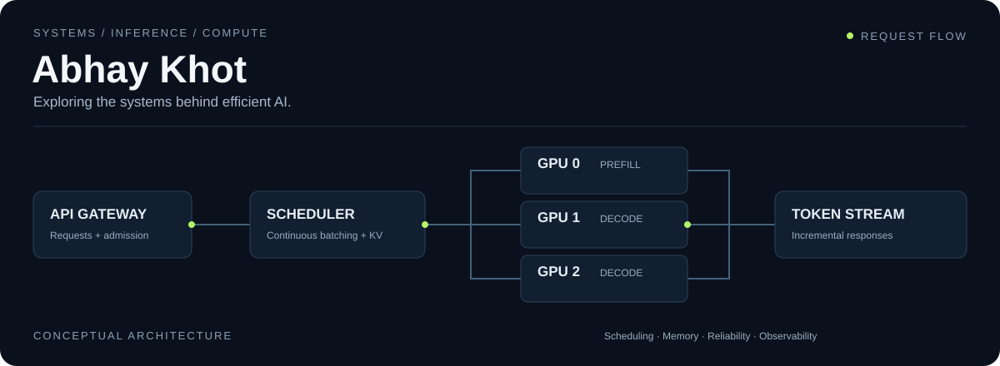

I build projects around **LLM inference infrastructure, distributed systems, and systems programming**. My interests include GPU computing, memory-aware scheduling, reliable request processing, and understanding where performance goes.

### Selected projects

- **[InferSched](https://github.com/Abhayrkhot/InferSched-Distributed-Inference-Scheduler)** · A distributed scheduling runtime with continuous batching, paged KV memory, Kafka routing, and PostgreSQL-backed recovery. C++ engines use simulated compute; this project studies scheduling and reliability, not GPU model execution. [Explore the architecture →](https://abhayrkhot.github.io/InferSched-Distributed-Inference-Scheduler/)
- **[LLM Inference Benchmark Suite](https://github.com/Abhayrkhot/LLM-inference-benchmark-suite)** · Python tooling for concurrent endpoint benchmarking, per-request timing, latency percentiles, and CSV reports. Token counts are approximated; the repository documents measurement limitations.
- **[Ferrum Edge](https://github.com/Abhayrkhot/ferrum-edge)** · An async HTTP reverse proxy in Rust with health-aware load balancing, circuit breaking, load shedding, and Prometheus metrics.
- **[ClaimBot SOP Harness](https://github.com/Abhayrkhot/ClaimBot-SOP-Harness)** · A model-assisted insurance claims agent with deterministic workflow and safety gates.

### Engineering interests

**Inference & compute** · Continuous batching, KV caching, GPU execution, latency and throughput measurement

**Distributed systems** · Durable queues, replication, failure recovery, fencing, and observability

**Tools in these projects** · C++ · Python · Rust · FastAPI · gRPC · Kafka · PostgreSQL · Redis · Docker

### Open-source interests

Exploring the internals of [vLLM](https://github.com/vllm-project/vllm), [SGLang](https://github.com/sgl-project/sglang), [etcd](https://github.com/etcd-io/etcd), and [workload-map](https://github.com/dsx-ai-factory/workload-map).

---

The header is a conceptual illustration of distributed inference, not live telemetry or a diagram of every project. Project documentation contains benchmark methods and limitations.
